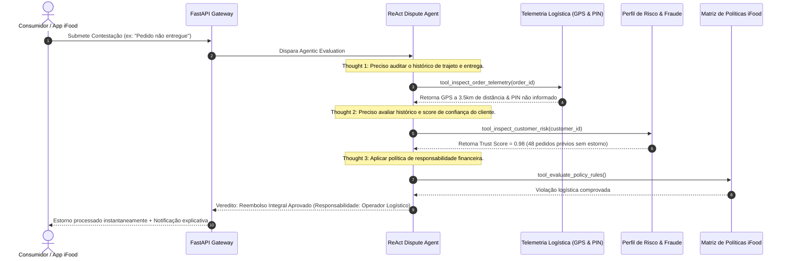

# ⚖️ iFood Async Dispute Resolver API (ReAct Pattern & Agentic Workers)

[](https://www.python.org/)
[](https://fastapi.tiangolo.com/)
[](https://arxiv.org/abs/2210.03629)
[](https://airflow.apache.org/)
[](tests/)
[](LICENSE)

> **Sistema autônomo baseado no padrão ReAct (Reasoning + Acting) para resolução automática, auditável e justa de disputas, contestações e estornos operacionais no ecossistema iFood.**

---

## 🎯 Impacto no Negócio iFood

Processar contestações de pedidos manualmente é lento, custoso e gera atrito com clientes, restaurantes e entregadores parceiros:
- **Redução de tempo de resolução (SLA):** De horas para milissegundos através de agentes autônomos.
- **Auditoria de Responsabilidade Financeira (*Liability Split*):** Identificação exata de quem deve arcar com o prejuízo (Restaurante parceiro por atraso na cozinha, Operador logístico por desvio de trajeto, Plataforma por cortesia de fidelidade, ou Cliente em casos de fraude).
- **Mitigação de Fraudes com Telemetria Integrada:** Cruzamento de logs em tempo real (GPS, Geofence, validação de PIN de confirmação de entrega e perfil de risco do consumidor).

---

## 🧠 Ciclo Cognitivo ReAct (Thought -> Action -> Observation)



---

## 📂 Estrutura do Projeto

```text
├── app/
│   ├── main.py                  # API FastAPI com endpoints REST e modo CLI
│   ├── models.py                # Modelos de dados e contratos de eventos
│   ├── compat.py                # Camada de abstração Pydantic v2 / Dataclasses
│   ├── agents/
│   │   └── react_agent.py       # Implementação do ciclo ReAct e Ferramentas (Tools)
│   └── tasks/
│       └── airflow_dag.py       # DAG do Apache Airflow para reconciliação batch noturna
├── tests/
│   └── test_dispute_resolver.py # Suíte de testes unitários para múltiplos cenários de disputas
├── Dockerfile                   # Build conteinerizado
├── docker-compose.yml           # Orquestração do serviço
└── requirements.txt             # Dependências
```

---

## ⚡ Como Executar

### 1. Testes Unitários
```bash
python -u tests/test_dispute_resolver.py
```
> Resultado esperado: **9 testes executados com 100% de sucesso**.

### 2. Demonstração Interativa via Terminal
```bash
python -u app/main.py
```

### 3. Simulação do DAG do Apache Airflow
```bash
python -u app/tasks/airflow_dag.py
```

### 4. Execução via Docker
Configure uma chave aleatória de pelo menos 32 caracteres na variável `DISPUTE_API_KEY` antes de iniciar o serviço. Por exemplo, no PowerShell:
```powershell
$env:DISPUTE_API_KEY = (& python -c "import secrets; print(secrets.token_urlsafe(32))")
docker-compose up --build
```
Envie essa chave no cabeçalho `X-API-Key` ao chamar o endpoint de avaliação. A inicialização via Docker falha se a chave não estiver configurada.
Acesse a documentação interativa Swagger em `http://localhost:8002/docs`.

---

## 📊 Matriz de Decisões do Agente

| Caso Testado | Causa Raiz Observada | Decisão Emitida | Responsabilidade Financeira |
| :--- | :--- | :--- | :--- |
| **ORD-101** | Motorista marcou entregue a 3.5km sem PIN | **Reembolso Integral** | Operador Logístico |
| **ORD-102** | Restaurante atrasou 70 minutos para despachar | **Reembolso Integral** | Restaurante Parceiro |
| **ORD-103** | PIN validado + GPS a 5m + histórico de chargeback | **Contestação Negada** | Cliente (Tentativa de Fraude) |
| **Fidelidade** | Avaria leve com cliente de alto trust score | **Voucher Imediato** | Plataforma iFood |

---

## 👨‍💻 Autor

**Lucas Oliveira Costa Pinto**  
- **LinkedIn:** [linkedin.com/in/lucas-oliveira-costa-pinto](https://www.linkedin.com/in/lucas-oliveira-costa-pinto/)  
- **GitHub:** [github.com/lucasocp](https://github.com/lucasocp)  
- **Curso:** Engenharia de Software – UCSal (Formação prevista: Dez/2028)
